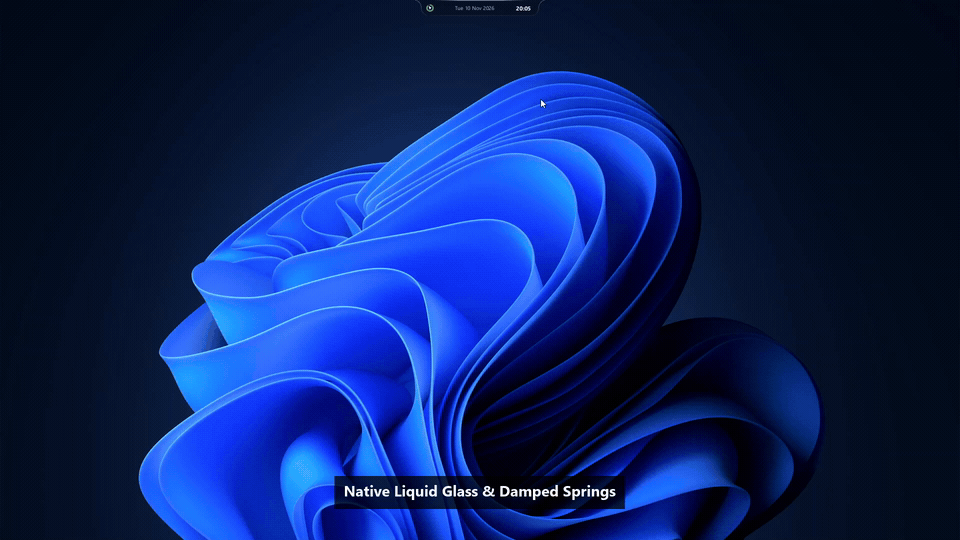

<div align="center">

# NotDynamicIsland 🏝️

**A featherweight, native Dynamic Island companion for Windows 10 & 11, crafted in pure Rust.**

[](https://github.com/Sarashinaa/NotDynamicIsland/releases/latest)
[](https://www.rust-lang.org/)
[](https://microsoft.com/windows)
[]()
[]()
[](LICENSE)

<br />

<p align="center">
  <a href="#-overview">Overview</a> •
  <a href="#showcase">Showcase</a> •
  <a href="#-key-features">Key Features</a> •
  <a href="#-performance-benchmark">Performance</a> •
  <a href="#-getting-started">Getting Started</a> •
  <a href="#-shortcuts--controls">Controls</a> •
  <a href="#-building-from-source">Build</a>
</p>

---

</div>

<br />

## ✦ Overview

**NotDynamicIsland** brings the fluid, context-aware Dynamic Island experience to Windows desktops with uncompromising performance. Built from bare metal with **zero web runtimes** (no Electron, no WebView2, no Chromium), it renders directly onto native Win32 layered surfaces using a bespoke software Signed Distance Field (SDF) rasterizer and mass-spring-damper kinetic physics.

The result is a desktop companion that feels organic, responds instantaneously, and sits at **0.0% CPU** and **under 10 MB RAM** throughout your workday.

<br />

<div id="showcase" align="center">

## ✦ Preview & Showcase



</div>

<br />

---

## ✦ Key Features

### 💎 Liquid Glass & Kinetic Aesthetics
- **Real-Time Optical Lens Diffusion**: In-house 60 FPS hardware-downsampled backdrop blur that softly diffuses windows and text behind the notch, preventing typography collision while preserving crystal-clear liquid glass transparency.
- **Dual Optical Materials**: Toggle seamlessly between **Dark Obsidian** (deep translucent tint with high transmission) and **Crystal-Clear Light** (high-clarity liquid glass with pristine desktop transmittance).
- **Dual-Stroke Optical Beveling**: 1.0px gradient outer contour with a 1.5px internal prism refraction layer that simulates genuine curved glass thickness.
- **Wet-Look Specular Highlight**: 1.8px high-intensity top-edge light arc with smooth horizontal falloff.
- **High-Refresh 125 FPS Kinetics**: Damped harmonic oscillator (`ζ ≈ 0.717`) ticking at 8ms resolution delivers butter-smooth 60–180Hz motion without micro-stutter.
- **Surgical Hit-Testing**: Native `HTTRANSPARENT` passthrough outside active curves allows clicking, selecting, and dragging windows directly beneath the transparent canvas.

<br />

### 🎵 Media Controller & Synchronized Lyrics
- **Universal Session Tracking**: Seamlessly hooks into Windows System Media Transport Controls (GSMTC) for Spotify, Apple Music, YouTube Music, Tidal, Foobar2000, and browsers.
- **Edge-Faded Synced Lyrics**: Real-time LRCLIB synchronization with smooth auto-scrolling and top/bottom opacity fade masks.
- **One-Click Romanization (`RO`)**: Instant mathematical transliteration for Japanese (Kanji/Kana) and Korean (Unicode Hangul decomposition) song titles and lyrics.
- **Interactive Scrubbing**: Precision audio progress bar with draggable thumb knob and ±5 second micro-seek buttons (`↺ 5` / `↻ 5`).

<br />

### 🗂️ Desktop Productivity Deck
- **Drop Shelf**: Stage up to 5 files or clipboard items by simply dragging them over the island. Click to instantly reveal in Windows Explorer.
- **Interactive To-Do List**: Quick task entry, persistent completion checkboxes, progress tracker, and mouse-wheel scrolling.
- **Calendar & Agenda**: Monthly calendar view with event badges. Synchronizes privately with Google Calendar via secret iCal feed (`calendar_sync.txt`).
- **Focus Timer**: Dedicated Pomodoro timer and stopwatch with one-click presets for deep work sessions.
- **Quick Control Hub**: Fast desktop utilities including Screen Snip (`Win+Shift+S`), Screen Eyedropper, and Microphone Mute toggle.

<br />

### 🔔 Native Hardware OSDs
- **WASAPI Audio HUD**: Event-driven volume popup hooked directly into Windows Core Audio.
- **Power & Battery Ring**: Real-time battery percentage gauge, AC fast-charge detection, and battery-saver highlights.
- **Display Brightness**: Smooth hardware brightness OSD.
- **Privacy Dot Matrix**: Instant hardware sensor indicators for active microphone and webcam usage.

<br />

---

## ✦ Performance Benchmark

Designed from the ground up for power users who refuse to sacrifice system resources for aesthetics.

| Benchmark Metric | NotDynamicIsland (Pure Rust) | Typical Electron Widget | Native WinUI 3 App |
| :--- | :---: | :---: | :---: |
| **Idle RAM Usage** | **~3.5 – 6.8 MB** *(trims to ~1.8 MB)* | ~150 – 350 MB | ~60 – 120 MB |
| **Idle CPU Usage** | **0.0%** *(Event-driven `GetMessageW`)* | 0.8% – 3.5% | 0.2% – 1.0% |
| **Binary Footprint** | **~840 KB** *(Single standalone .exe)* | ~120 MB+ | ~45 MB+ |
| **GPU VRAM Overhead** | **0 MB** *(Software SDF Rasterizer)* | 80 – 200 MB | 40 – 80 MB |
| **Cold Launch Time** | **< 40 ms** | 1,800 – 3,500 ms | 600 – 1,200 ms |
| **External Runtimes** | **None** *(Pure Win32 API)* | Node.js + Chromium | .NET + Windows App SDK |

<br />

---

## ✦ Shortcuts & Controls

| Action | Interaction |
| :--- | :--- |
| **Expand / Collapse Island** | Hover anywhere on the notch |
| **Toggle Light / Dark Glass** | Click the kinetic Sun / Moon switch at the top-left of the Music player |
| **Cycle Functional Pages** | Click `<` / `>` arrow buttons, bottom dots, or swipe / mouse-wheel horizontally |
| **Open Synced Lyrics** | Click the speech bubble icon `💬` on the music card |
| **Toggle Romaji Mode** | Click the `RO` badge next to the lyrics toggle |
| **Micro-Seek Audio (±5s)** | Click `↺ 5` or `↻ 5` on the playback bar |
| **Stage Files** | Drag any file or image from Windows Explorer directly onto the notch |
| **Context Menu & Quick Tools** | Right-click the notch for clean Windows 11 Fluent dark context menu |

<br />

---

## ✦ Getting Started

### Ready-to-Run (No Installation Required)

1. Head to the [Latest Releases](https://github.com/Sarashinaa/NotDynamicIsland/releases/latest) page.
2. Download **`NotDynamicIsland-v2.0-windows-x64.zip`** (or standalone `not_dynamic_island.exe`).
3. Extract and double-click `not_dynamic_island.exe`. The notch will immediately anchor to the top-center of your primary display.

> [!TIP]
> **Start on Windows Boot**: Press `Win + R`, type `shell:startup`, and create a shortcut to `not_dynamic_island.exe` in that folder.

<br />

### Google Calendar Integration

To synchronize your personal agenda:
1. Open Google Calendar in your web browser &rarr; **Settings** &rarr; Select your calendar.
2. Scroll to **Integrate calendar** &rarr; Copy the **Secret address in iCal format** URL.
3. Paste the URL into `calendar_sync.txt` (located next to the executable).
4. The Island refreshes events in the background every 20 minutes, or instantly when clicking the `↻` button.

<br />

---

## ✦ Building from Source

### Prerequisites
- Windows 10 or 11 (x86_64)
- [Rust Toolchain](https://rustup.rs/) (Stable channel, Edition 2024 / 2021)

```powershell
# 1. Clone the repository
git clone https://github.com/Sarashinaa/NotDynamicIsland.git
cd NotDynamicIsland

# 2. Run the unit test suite (17 tests verifying math, shelf, blur, and parsers)
cargo test

# 3. Build optimized release binary with LTO
cargo build --release
```

The compiled standalone executable will be generated at `target\release\not_dynamic_island.exe`.

<br />

---

## ✦ Community & Architecture

Contributions, issue reports, and feature requests are warmly welcomed.
- **Language**: 100% Pure Rust (`windows-rs` bindings)
- **Rendering**: In-house Direct32 software rasterizer, analytic rounded rectangles, Gaussian blur passes, and SIMD-friendly blend operators.
- **Kinetics**: Second-order mass-spring-damper equations solved per-frame without frame drops.

<br />

## ✦ License

This project is licensed under the [MIT License](LICENSE).
Feel free to use, modify, and distribute it freely.
